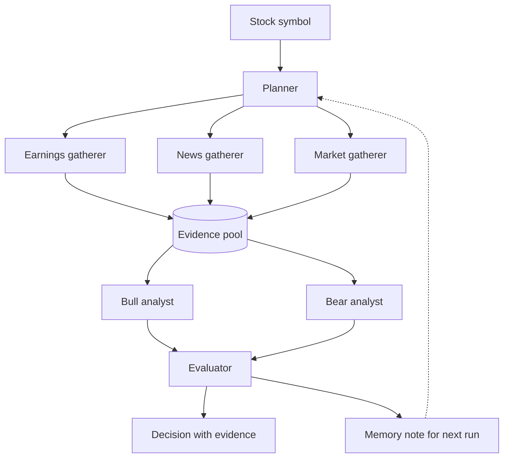

# AAI-520-Final-Project

Natural Language Processing and GenAI (AAI-520-03)

**AI Investment Committee**: a multi-agent stock research system. A planner gathers earnings, news, and market evidence for a stock symbol; Bull and Bear analysts argue both sides from the evidence pool; an evaluator checks which claims the evidence actually supports; and a memory note carries what was learned into the next run. Built by Michael Valderrama and Guna Pasupathy for the AAI-520 Final Team Project (University of San Diego, MS in Applied AI, Fall 2026).

[](https://github.com/ibucketbranch/AAI-520-Final-Project/actions/workflows/ci.yml)

TODO: Canvas README requirements (Instruction-README_GitHub-AAI.pdf, Canvas file 4747770) not yet incorporated; Michael to download and reconcile.

## Architecture

Full detail in [docs/ARCHITECTURE.md](docs/ARCHITECTURE.md).



## Rubric map

[docs/RUBRIC_MAP.md](docs/RUBRIC_MAP.md) maps every graded item to where it lives in `src/` and where the notebook demonstrates it. Updated weekly.

## Quick start

```bash
git clone git@github.com:ibucketbranch/AAI-520-Final-Project.git
cd AAI-520-Final-Project
make setup                 # venv, editable install, pre-commit hooks
cp .env.example .env       # fill in the keys you have
make check                 # everything CI runs
make run                   # CLI help
```

## Repository layout

```
src/investment_committee/   the package: agents/, tools/, workflows/, memory/, evaluation/
tests/                      pytest suite (no network; tools are mocked)
notebooks/dev/              per-person dev notebooks, outputs stripped on commit
notebooks/final/            the single submitted notebook, assembled in the last week
docs/                       architecture, rubric map, AI disclosure standard, ADRs
data/                       local datasets, gitignored
scripts/                    repo checks run by hooks and CI
```

## Team, roles, and milestones

[docs/TEAM.md](docs/TEAM.md): members, time zones, the standing call, and the
lead. Per-area owners live in [docs/ARCHITECTURE.md](docs/ARCHITECTURE.md) and
.github/CODEOWNERS. The dated plan is [docs/MILESTONES.md](docs/MILESTONES.md).


## Working agreements

[CONTRIBUTING.md](CONTRIBUTING.md): branch flow, reviews, ownership, notebooks, secrets, decisions, cadence.

## AI tool disclosure

[docs/AI_DISCLOSURE.md](docs/AI_DISCLOSURE.md): the disclosure standard for PRs and for the final notebook.

## References

Anthropic. (2024). *Building effective agents*. https://www.anthropic.com/research/building-effective-agents

Du, Y., Li, S., Torralba, A., Tenenbaum, J. B., & Mordatch, I. (2023). *Improving factuality and reasoning in language models through multiagent debate*. International Conference on Machine Learning. https://arxiv.org/abs/2305.14325

Panickssery, A., Bowman, S. R., & Feng, S. (2024). *LLM evaluators recognize and favor their own generations*. Advances in Neural Information Processing Systems. https://arxiv.org/abs/2404.13076

Xiao, Y., Sun, E., Luo, D., & Wang, W. (2024). *TradingAgents: Multi-agents LLM financial trading framework*. https://arxiv.org/abs/2412.20138

## License

MIT, see [LICENSE](LICENSE).
