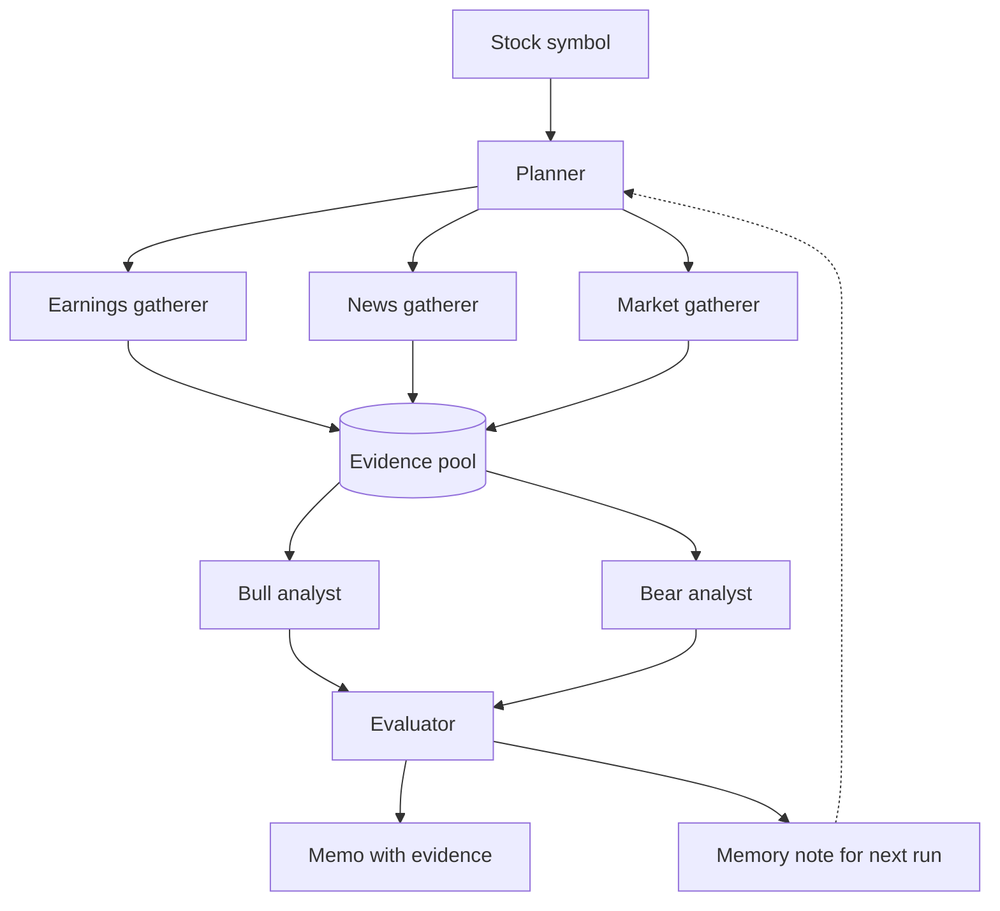

# AI Investment Committee

Multi-agent stock research, built for the AAI-520 Final Team Project.

This project is a part of the AAI-520 course in the Applied Artificial Intelligence Program at the University of San Diego (USD).

-- Project Status: Completed

[](https://github.com/ibucketbranch/AAI-520-Final-Project/actions/workflows/ci.yml)


| | |
|---|---|
| University | University of San Diego, M.S. in Applied Artificial Intelligence |
| Course | AAI-520-03, Natural Language Processing and GenAI, Fall 2026 |
| Instructor | Andrew Van Benschoten |
| Team | Group 7: Michael Valderrama, Guna Pasupathy, Mina Habib |
| Due | Final notebook Oct 19, 2026 |

## Team and Contributors

| Name | GitHub |
|------|--------|
| Michael Valderrama | [@ibucketbranch](https://github.com/ibucketbranch) |
| Guna Pasupathy | [@gunaphysics](https://github.com/gunaphysics) |
| Mina Habib | [@habibmn09](https://github.com/habibmn09) |

Time zones in [docs/TEAM.md](docs/TEAM.md); design in [docs/ARCHITECTURE.md](docs/ARCHITECTURE.md).

## Project Intro/Objective

You give it a stock symbol. It comes back with a short memo and a bull, bear, or none verdict, where every claim points at the evidence it came from, plus a note for the next run.

1. A **planner** decides what to gather for the symbol.
2. Three gatherers fill an **evidence pool**: earnings (last quarter), news (events that could move the price), and market indicators (RSI, MACD, price history via yfinance). News goes through a six-step chain first: ingest, preprocess, classify, gate, extract, summarize.
3. A **Bull analyst** and a **Bear analyst** argue their sides from the pool.
4. An **evaluator** checks which claims the evidence supports and sends unsupported ones back for revision.
5. The system writes a short **memory note** that the planner reads on the next run.



Full design in [docs/ARCHITECTURE.md](docs/ARCHITECTURE.md); the decision record is [docs/adr/0002](docs/adr/0002-investment-committee-design.md).

## How it maps to the assignment

| Requirement | Where it is |
|-------------|-------------|
| Plans its research steps | `agents/planner.py` |
| Uses tools dynamically | `tools/market.py`, `tools/earnings.py`, `tools/news.py` |
| Self-reflects on output quality | `agents/evaluator.py` |
| Learns across runs | `storage.py` (`save_memory_note`, `load_latest_note`) |
| Prompt chaining | `workflows/chaining.py` |
| Routing | `workflows/routing.py` |
| Evaluator-optimizer | `workflows/evaluator_optimizer.py` |

Notebook section per row in [docs/RUBRIC_MAP.md](docs/RUBRIC_MAP.md).

## Project Description

The committee researches one stock symbol per run. The planner uses OpenAI by default and can fall back to the rule-based plan when no key is available. Market and earnings numbers come from yfinance (price history, RSI, MACD, last-quarter results); live news comes from yfinance, then NewsAPI when `NEWSAPI_KEY` is set, then yfinance Search headlines (Yahoo's ticker news feed has returned nothing since early October); saved article JSON and committed synthetic fixtures under `tests/fixtures/` let tests and the notebook run offline with no key. A local SQLite database is built on first run from committed sample data and holds the evidence pool, run transcripts, and cross-run memory notes; `storage.py` is the only module that touches it. The evaluation section asks whether the evaluator loop raises the share of supported claims. We ran three stocks with and without the loop and counted supported and rejected claims per run; the results are in sections 7 and 8 of the notebook. A known roadblock is that yfinance is an unofficial Yahoo interface and can break without notice.

## Methods Used

- NLP preprocessing and entity extraction (the six-step news chain, spaCy NER)
- Multi-agent LLM workflows: prompt chaining, routing, evaluator-optimizer
- Technical market indicators (RSI, MACD)
- Claim-evidence evaluation (supported vs unsupported claim counts)
- Cross-run memory notes

## Technologies

- Python 3.11, pandas, numpy, pydantic, OpenAI API
- yfinance, spaCy
- SQLite
- pytest with a 90 percent coverage floor, ruff, mypy, pre-commit, GitHub Actions

## Design decisions

- **SQLite, one owner.** The notebook builds a local database on first run from committed sample data. One person owns the schema and `storage.py`; everything else goes through that module. Database files are never committed. [ADR-0003](docs/adr/0003-storage-choice.md)
- **Contracts first.** `models.py` (shared record shapes) and `storage.py` (the only door to the database) landed by Sep 22 so the three of us could build in parallel.
- **Selectable planner.** The UI uses OpenAI by default and keeps the rule-based planner as an offline option and fallback. [ADR-0005](docs/adr/0005-planner-provider.md)
- **Stretch:** a small Streamlit UI was built (`make ui`). NLI claim checking, RAG over SEC EDGAR filings, and a cross-model judge were not; section 8 of the notebook lists them under more time.

## Plan

| Tuesday | Module | Milestone |
|---------|--------|-----------|
| Sep 15 | 2 | Repo up with CI, proposal agreed, owners named |
| Sep 22 | 3 | Data layer done, sample data committed, SQLite builds on first run, news chain runs on saved articles |
| Sep 29 | 4 | Walking skeleton end to end with stubs; Status Update Form submitted Sep 28 |
| Oct 6 | 5 | Real planner, real Bull and Bear, one model wired |
| Oct 13 | 6 | Review loop and memory note working; with/without measurement run |
| Oct 20 | 7 | Final submitted Oct 19; peer eval and retro |

Per-person deliverables in [docs/MILESTONES.md](docs/MILESTONES.md).

## Installation

```bash
git clone git@github.com:ibucketbranch/AAI-520-Final-Project.git
cd AAI-520-Final-Project
make setup                 # venv, editable install, spaCy model, pre-commit hooks
cp .env.example .env       # add the keys you have
make check                 # everything CI runs
make run                   # CLI help
make ui                    # local UI at http://localhost:8501
```

Set `OPENAI_API_KEY` in `.env` to use the OpenAI planner. The Planner menu in
the UI defaults to OpenAI and also offers the rule-based planner for offline runs.
Choosing OpenAI shows only the current model aliases: `gpt-6-luna` (default),
`gpt-6-sol`, and `gpt-6-astra`, when available to your API key. Older models and
dated snapshots are hidden. The selected model overrides `OPENAI_MODEL` for that
run. The list is cached for five minutes;
the refresh button reloads it. If the list cannot be loaded, the page shows a
warning and keeps a current default available. Rule-based planning needs no model.

Each UI run is saved locally to `data/committee.db`. Earnings and market evidence are
available immediately; news is saved as evidence after it passes through the news chain.

Requires Python 3.11. Tests run with no network; the tools are mocked.

## Repository layout

```
src/investment_committee/   the package: agents/, tools/, workflows/, memory/, evaluation/
tests/                      pytest suite, fixtures under tests/fixtures/
notebooks/dev/              per-person dev notebooks, outputs stripped on commit
notebooks/final/            the submitted notebook (Full) and a shorter Light copy
docs/                       architecture, milestones, team, rubric map, AI disclosure, ADRs
data/                       local datasets and the SQLite file, gitignored
scripts/                    repo checks run by hooks and CI
```

## Working agreements

Branch, PR, one review, squash merge. One owner per area; others change it through a PR the owner reviews. No secrets, datasets, database files, or notebook outputs in git. Full agreement in [CONTRIBUTING.md](CONTRIBUTING.md).

## AI tool disclosure

Each author discloses in the first person what tool did what and what the author verified: [docs/AI_DISCLOSURE.md](docs/AI_DISCLOSURE.md).

## References

Anthropic. (2024). *Building effective agents*. https://www.anthropic.com/research/building-effective-agents

Du, Y., Li, S., Torralba, A., Tenenbaum, J. B., & Mordatch, I. (2023). *Improving factuality and reasoning in language models through multiagent debate*. International Conference on Machine Learning. https://arxiv.org/abs/2305.14325

Panickssery, A., Bowman, S. R., & Feng, S. (2024). *LLM evaluators recognize and favor their own generations*. Advances in Neural Information Processing Systems. https://arxiv.org/abs/2404.13076

Xiao, Y., Sun, E., Luo, D., & Wang, W. (2024). *TradingAgents: Multi-agents LLM financial trading framework*. https://arxiv.org/abs/2412.20138

## Acknowledgments

Thanks to our instructors Kahila Mokhtari Jadid, Mirsardar Esmaeili, and Andrew Van Benschoten for guidance throughout the course.

## License

MIT, see [LICENSE](LICENSE).
