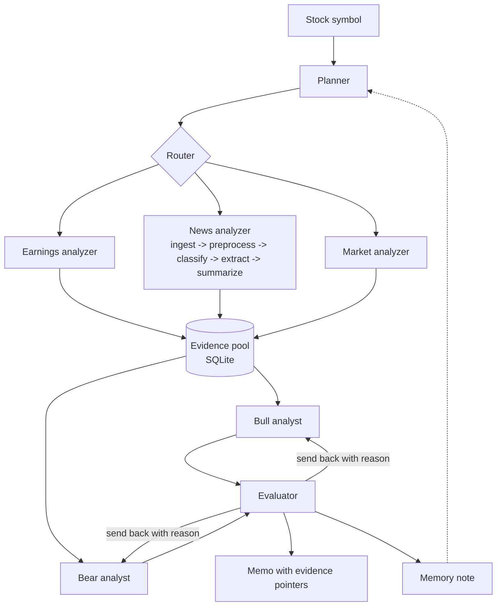

# AI Investment Committee

Multi-agent stock research, built for the AAI-520 Final Team Project.

[](https://github.com/ibucketbranch/AAI-520-Final-Project/actions/workflows/ci.yml)


| | |
|---|---|
| University | University of San Diego, M.S. in Applied Artificial Intelligence |
| Course | AAI-520-03, Natural Language Processing and GenAI, Fall 2026 |
| Instructor | Andrew Van Benschoten |
| Team | Group 7 |
| Due | Final notebook Oct 19, 2026 |

<!-- Issue #3: reconcile this README against the course README requirements
     (Instruction-README_GitHub-AAI.pdf, Canvas file 4747770). -->

## Team

| Name | GitHub | Owns |
|------|--------|------|
| Michael Valderrama | [@ibucketbranch](https://github.com/ibucketbranch) | Bull and Bear analysts, the review loop, self-reflection and memory note, repo and CI, final notebook |
| Guna Pasupathy | [@gunaphysics](https://github.com/gunaphysics) | Data and storage: market, earnings, and news tools, the SQLite module and schema, sample data, planner and router |
| Mina Habib | [@habibmn09](https://github.com/habibmn09) | News chain (ingest to summarize), then the evaluation harness and charts |

Standing call Tuesdays 4:30 PM PT. Details, time zones, and the lead role in [docs/TEAM.md](docs/TEAM.md).

## What it does

You give it a stock symbol. It comes back with a buy or do-not-buy memo where every claim points at the evidence it came from, and a note to itself about what to do better next time.

Under the hood, six things happen in order:

1. A **planner** reads the last run's memory note and decides what to gather for this symbol.
2. A **router** sends each research item to the right specialist: earnings, news, or market indicators (RSI, MACD, price history via yfinance).
3. The three specialists fill an **evidence pool**. News goes through a five-step chain first: ingest, preprocess, classify, extract, summarize.
4. A **Bull analyst** and a **Bear analyst** each argue their side from the pool. Every claim carries a pointer to the evidence item behind it.
5. An **evaluator** checks which claims the evidence supports and sends the unsupported ones back with a reason. The analysts revise. This loop runs until the evaluator accepts or the retry budget runs out.
6. The system writes a short **memory note** so the next run starts smarter.



Full design, component owners, and the stretch list in [docs/ARCHITECTURE.md](docs/ARCHITECTURE.md). The decision record is [docs/adr/0002](docs/adr/0002-investment-committee-design.md).

## How it maps to the assignment

The assignment asks for four agent functions and three workflow patterns. Each one is a named piece of this system, not a bolt-on.

| Requirement | Where it is |
|-------------|-------------|
| Plans its research steps | `agents/planner.py` |
| Uses tools dynamically | `tools/market.py`, `tools/earnings.py`, `tools/news.py` |
| Self-reflects on output quality | the drafting step writes its own confidence and open gaps before review; `agents/evaluator.py` |
| Learns across runs | `memory/store.py`, the note the planner reads at the start of the next run |
| Prompt chaining | `workflows/chaining.py` |
| Routing | `workflows/routing.py` |
| Evaluator-optimizer | `workflows/evaluator_optimizer.py` |

[docs/RUBRIC_MAP.md](docs/RUBRIC_MAP.md) tracks the status of each row and where the final notebook demonstrates it.

## How we know it works

Same tickers, two runs each: with the review loop and without. Count supported vs unsupported claims in the final memo. If the loop earns its place, the supported share goes up. The harness and charts live in `evaluation/`.

Every model call (prompt, response, tokens, latency) is logged to the same SQLite file, so the final notebook can replay a run with no API key and the cost of a run falls out of the log.

## Design decisions

- **SQLite, one owner.** The notebook builds a local database on first run from committed sample data. One person owns the schema and `storage.py`; everything else goes through that module. Database files are never committed. [ADR-0003](docs/adr/0003-storage-choice.md)
- **Contracts first.** `models.py` (the shared record shapes) and `storage.py` (the only door to the database) land before anything else, so three people can build in parallel without touching each other's code.
- **One model client, swappable by env var.** `MODEL_NAME` and `BASE_URL` in `.env`; the model is a config change, not a code change.
- **Stretch, in this order, only if v1 is done:** NLI claim checking against cited evidence, RAG over SEC EDGAR filings, a judge from a different model family than the generators (Panickssery et al., 2024), and a small ticker-entry UI last.

## Plan

We plan by dated Tuesday check-ins, not course modules. The module column is a cross-reference for the instructor.

| Tuesday | Module | Milestone |
|---------|--------|-----------|
| Sep 15 | 2 | Repo up with CI, proposal agreed, owners named |
| Sep 22 | 3 | Data layer done, sample data committed, SQLite builds on first run, news chain runs on saved articles |
| Sep 29 | 4 | Walking skeleton end to end with stubs; Status Update Form submitted Sep 28 |
| Oct 6 | 5 | Real planner, real Bull and Bear, one model wired |
| Oct 13 | 6 | Review loop and memory note working; with/without measurement run |
| Oct 20 | 7 | Final submitted Oct 19; peer eval and retro |

Per-person deliverables for each week are in [docs/MILESTONES.md](docs/MILESTONES.md).

## Quick start

```bash
git clone git@github.com:ibucketbranch/AAI-520-Final-Project.git
cd AAI-520-Final-Project
make setup                 # venv, editable install, pre-commit hooks
cp .env.example .env       # add the keys you have; none are required for replay
make check                 # everything CI runs: lint, types, tests, notebook hygiene, secrets
make run                   # CLI help
```

Requires Python 3.11. Tests run with no network; the tools are mocked.

## Repository layout

```
src/investment_committee/   the package
  agents/                   planner, bull, bear, evaluator
  tools/                    market, earnings, news (yfinance and saved data)
  workflows/                chaining, routing, evaluator_optimizer
  memory/                   cross-run notes
  evaluation/               with/without-review harness and metrics
  models.py                 shared record shapes (Evidence, Claim, MemoryNote, ModelCall)
  storage.py                the only module that touches the database
tests/                      pytest suite, fixtures under tests/fixtures/
notebooks/dev/              per-person dev notebooks, outputs stripped on commit
notebooks/final/            the single submitted notebook, assembled in the last week
docs/                       architecture, milestones, team, rubric map, AI disclosure, ADRs
data/                       local datasets and the SQLite file, gitignored
scripts/                    repo checks run by hooks and CI
```

## Working agreements

Branch, PR, one review, squash merge. Conventional Commit titles. One owner per area; others change it through a PR the owner reviews. No secrets, datasets, database files, or notebook outputs in git. The full agreement is [CONTRIBUTING.md](CONTRIBUTING.md); decisions that change the design get an ADR under [docs/adr/](docs/adr/).

## AI tool disclosure

We use AI tools and say so, precisely: each author discloses in the first person what tool did what and what the author verified. The standard for PRs and for the final notebook is [docs/AI_DISCLOSURE.md](docs/AI_DISCLOSURE.md).

## References

Anthropic. (2024). *Building effective agents*. https://www.anthropic.com/research/building-effective-agents

Du, Y., Li, S., Torralba, A., Tenenbaum, J. B., & Mordatch, I. (2023). *Improving factuality and reasoning in language models through multiagent debate*. International Conference on Machine Learning. https://arxiv.org/abs/2305.14325

Panickssery, A., Bowman, S. R., & Feng, S. (2024). *LLM evaluators recognize and favor their own generations*. Advances in Neural Information Processing Systems. https://arxiv.org/abs/2404.13076

Xiao, Y., Sun, E., Luo, D., & Wang, W. (2024). *TradingAgents: Multi-agents LLM financial trading framework*. https://arxiv.org/abs/2412.20138

## License

MIT, see [LICENSE](LICENSE).
