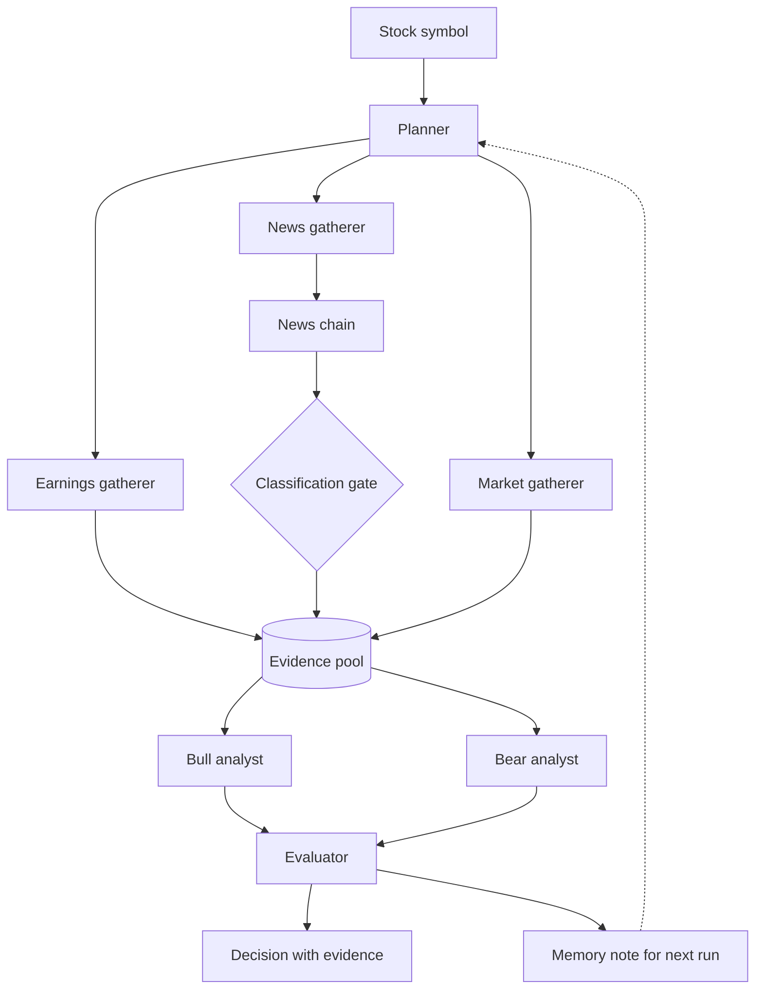

# Architecture

**Overview:** the v1 flow as agreed on the 2026-09-13 planning call (docs/adr/0002). A planner gathers evidence for a stock symbol, Bull and Bear argue from the pool, an evaluator checks claim support, and a memory note carries forward to the next run.

The detailed handoffs and team ownership are shown in
[WORKFLOW_SEQUENCE.md](WORKFLOW_SEQUENCE.md).

## v1 flow

Every Bull and Bear claim carries a pointer to the evidence item it came from; the evaluator counts supported vs unsupported claims and sends unsupported ones back with the reason attached. News is promoted into the same shared `Evidence` model only after the classification gate accepts its category; rejected `general` items remain visible in chain output but cannot enter the evidence pool.

## Components and owners

| Component | Lives in | Responsibility | Owner |
|-----------|----------|----------------|-------|
| Planner | `src/investment_committee/agents/planner.py` | Plans research steps for a symbol, reads last run's memory note | @gunaphysics |
| Earnings tool | `src/investment_committee/tools/earnings.py` | Last quarter results | @gunaphysics |
| News tool | `src/investment_committee/tools/news.py` | Headlines and events that could move the price | @gunaphysics |
| Market tool | `src/investment_committee/tools/market.py` | Price history and indicators (RSI, MACD) | @gunaphysics |
| Bull analyst | `src/investment_committee/agents/bull.py` | Optimistic case, every claim with an evidence pointer | @ibucketbranch |
| Bear analyst | `src/investment_committee/agents/bear.py` | Pessimistic case, every claim with an evidence pointer | @ibucketbranch |
| Evaluator | `src/investment_committee/agents/evaluator.py` | Checks supported vs unsupported claims, feeds refinement | @ibucketbranch |
| Chaining workflow | `src/investment_committee/workflows/chaining.py` | Ingest -> preprocess -> classify -> gate -> extract -> summarize; promote accepted news to shared `Evidence` | @habibmn09 |
| Routing workflow | `src/investment_committee/workflows/routing.py` | Sends content to the right specialist | @gunaphysics |
| Evaluator-optimizer workflow | `src/investment_committee/workflows/evaluator_optimizer.py` | Generate -> evaluate -> refine loop | @ibucketbranch |
| Memory store | `src/investment_committee/memory/store.py` | Cross-run notes (backend pending ADR-0003) | @gunaphysics |
| Metrics | `src/investment_committee/evaluation/metrics.py` | Supported vs unsupported claim counts per run | @habibmn09 |
| Final notebook | `notebooks/final/` | The submitted deliverable, assembled from the package | @ibucketbranch |

## Stretch (documented, may not ship)

- NLI claim checking: run each claim against its cited evidence with an NLI model (entailed / contradicted / unsupported).
- RAG over EDGAR filings for the earnings analyst.
- Cross-model evaluation: a judge from a different model family than the generators, since LLM judges favor their own outputs (Panickssery et al., 2024).

## Contracts first

Two files are the contracts everything else imports, both owned by
@gunaphysics and due Sep 22: `src/investment_committee/models.py` (the shared
record shapes: Evidence, Claim, MemoryNote, run metadata) and
`src/investment_committee/storage.py` (the only door to the SQLite database,
per ADR-0003). Once those two are merged, the three lanes build in parallel.

## Duo fallback

If the team drops back to two, the plan does not get redrawn; two lines move
and everything else stands: the news chain goes to Michael (its v1 is already
merged), and the evaluation harness splits with Guna building the runner and
Michael writing the analysis and charts.
