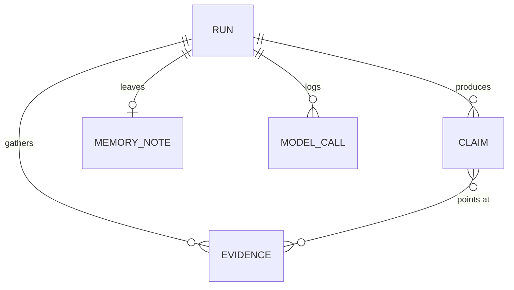

# Data model

**Overview:** the five records every component shares. They are defined once in `src/investment_committee/models.py` and stored by `src/investment_committee/storage.py` in one SQLite file (ADR-0003). Field names are column names, so this page describes both the Python objects and the tables.

## How the records relate

Everything hangs off a run. A claim points at one or more evidence rows by id; that link is a list inside the claim, not a separate table.

## Who writes what, who reads it

| Record | Written by | Read by |
|--------|-----------|---------|
| Run | planner at the start (`save_run`), evaluator at the end (`finish_run`) | evaluation harness, final notebook |
| Evidence | the earnings, news, and market gatherers | Bull, Bear, evaluator |
| Claim | Bull and Bear; the evaluator saves it again with its verdict | evaluator, metrics |
| MemoryNote | the drafting step, once per run | planner at the start of the next run |
| ModelCall | any stage that calls a language model | notebook replay, cost accounting |

## Run

One end-to-end research run for a symbol.

| Field | Type | Meaning |
|-------|------|---------|
| run_id | text | generated, 12 hex chars |
| symbol | text | the ticker, for example AAPL |
| with_review | bool | true normally; false for the "without the review loop" runs in the evaluation |
| started_at | text | ISO 8601 UTC, generated |
| finished_at | text or null | set by `finish_run` |
| memo | text or null | the final memo, set by `finish_run` |

## Evidence

One fact a gatherer found. The evidence pool is the list of these for a run.

| Field | Type | Meaning |
|-------|------|---------|
| evidence_id | text | generated |
| run_id | text | the run it belongs to |
| symbol | text | the ticker |
| source | text | one of `earnings`, `news`, `market` |
| title | text | short label, for example "Quarterly revenue" or "RSI(14)" |
| content | text | the fact itself, as a sentence |
| as_of | text | the date the fact refers to |
| reference | text | where it came from: a URL, or something like `yfinance:AAPL:income_stmt` |

## Claim

One statement from Bull or Bear.

| Field | Type | Meaning |
|-------|------|---------|
| claim_id | text | generated |
| run_id | text | the run it belongs to |
| side | text | `bull` or `bear` |
| text | text | the statement |
| evidence_ids | list of text | the evidence rows it rests on; at least one (ADR-0002) |
| supported | bool or null | null until the evaluator decides |
| reason | text or null | the evaluator's note when a claim is sent back |
| revision | int | 0 at first; +1 each time the claim is rewritten |

## MemoryNote

What a run learned, for the next run on the same symbol. This is the self-reflection record from the proposal: the drafting step writes its own confidence and what it could not find out.

| Field | Type | Meaning |
|-------|------|---------|
| note_id | text | generated |
| run_id | text | the run that wrote it |
| symbol | text | the ticker |
| confidence | float | 0 to 1 |
| open_gaps | list of text | questions the run could not answer |
| lesson | text | one short note to the next run |
| created_at | text | ISO 8601 UTC, generated |

## ModelCall

One call to a language model, kept so the final notebook can replay a run with no key and so the cost of a run can be added up.

| Field | Type | Meaning |
|-------|------|---------|
| call_id | text | generated |
| run_id | text | the run it belongs to |
| stage | text | who called: planner, bull, bear, evaluator |
| model | text | model name as the API reports it |
| prompt | text | what was sent |
| response | text | what came back |
| prompt_tokens | int | from the API; 0 for stubs |
| completion_tokens | int | from the API; 0 for stubs |
| latency_ms | int | wall time of the call; 0 for stubs |
| created_at | text | ISO 8601 UTC, generated |

## Rules the models enforce

- A claim must point at at least one evidence row. Building a `Claim` with an empty `evidence_ids` raises.
- `source` and `side` only accept the labels above.
- `confidence` must be between 0 and 1.
- Ids and timestamps are filled in automatically when a record is built, so callers only supply the content fields.

## How it is stored

- One file, `data/committee.db` by default. `data/` is gitignored, so it is never committed. Tests open `:memory:`.
- The runner saves the `Run` plus earnings and market evidence immediately. Raw news stays in the runner snapshot until the news chain converts it to `Evidence`.
- Tables are named `runs`, `evidence`, `claims`, `memory_notes`, `model_calls`, with the columns above.
- The two list fields (`evidence_ids`, `open_gaps`) are stored as JSON text in one column. Booleans are stored as 0 and 1. Timestamps are ISO 8601 text.
- Foreign keys are on: a row cannot be saved for a run that has not been saved.
- A new run and its initial evidence are saved in one transaction. If either insert fails, neither is kept.
- The evaluator records a verdict by saving the same `Claim` again with `supported` and `reason` filled in; the row is replaced.
- On first run the notebook calls `seed_from_json(conn, path)` with a file shaped `{"run": {...}, "evidence": [...]}`. If that run id is already in the database the call does nothing, so it is safe to call every time.

## The functions in storage.py

| Function | What it does |
|----------|--------------|
| `open_db(path)` | open the file, create the tables if missing, return the connection |
| `save_run`, `finish_run` | start a run; record its memo and end time |
| `save_evidence` | insert a batch of evidence rows |
| `save_run_with_evidence` | atomically insert a run and its initial evidence |
| `save_claim` | insert a claim, or replace it if the id exists |
| `save_memory_note`, `save_model_call` | insert one row |
| `load_run`, `load_evidence`, `load_claims`, `load_model_calls` | read back by run id, in saved order |
| `load_latest_note(symbol)` | the newest memory note for a symbol, or None on the first run |
| `seed_from_json(path)` | first-run build from a committed sample file |

## Things to decide

- Should `Evidence` carry a numeric `value` column for market and earnings numbers, or is a sentence in `content` enough for the analysts?
- Is one `MemoryNote` per run the right grain, or should a run be allowed to leave several?
- Does `Run` need a separate `decision` field (buy / do not buy) next to the free-text `memo`?
