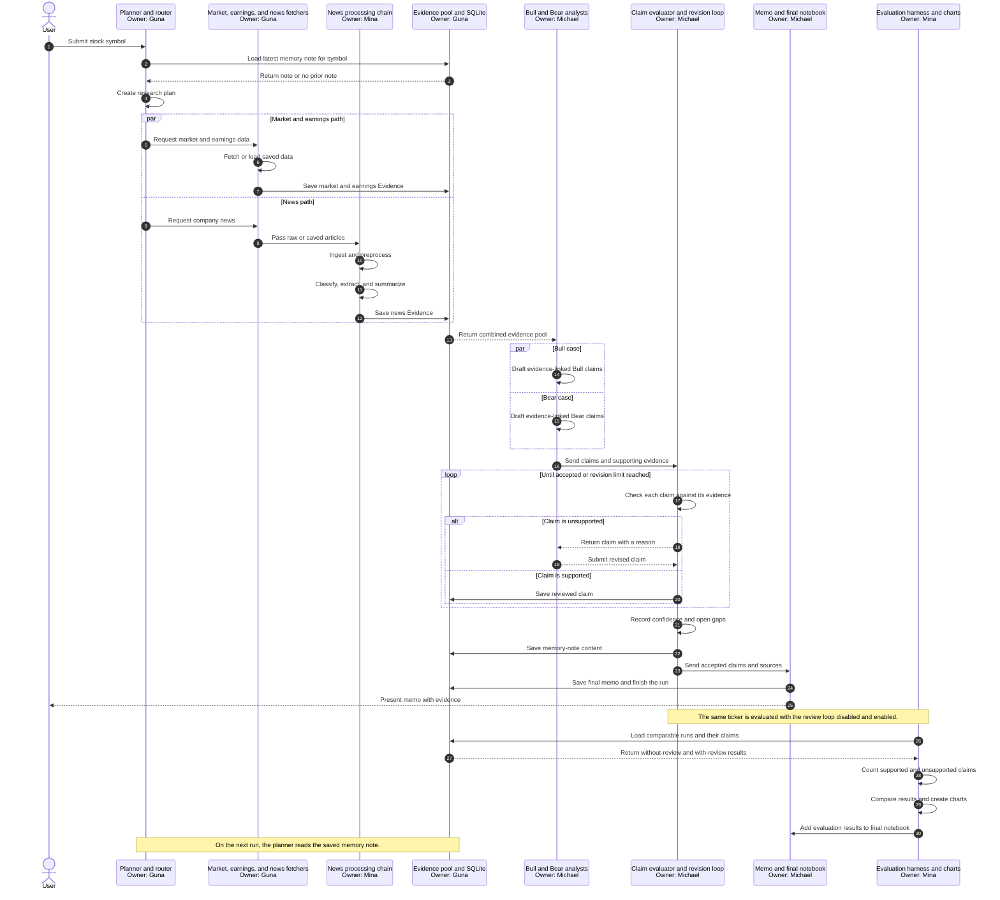

# Workflow sequence and ownership

This diagram shows the sequence of one research run, the handoffs between
team members, and the separate evaluation performed across runs.

## Dependency summary

1. The shared models and SQLite storage contract enable all three work lanes.
2. Mina can develop the news chain from saved articles without waiting for live
   news fetching.
3. Michael can develop the analysts and evaluator from saved Evidence without
   waiting for the live gatherers.
4. The walking skeleton requires all three lanes to meet at the evidence pool.
5. Mina can build the evaluation harness structure early, but the final
   comparison depends on Michael's review loop producing both reviewed and
   unreviewed results.
6. Michael creates the memory-note content; Guna's storage module persists it,
   and Guna's planner reads it on the next run.
